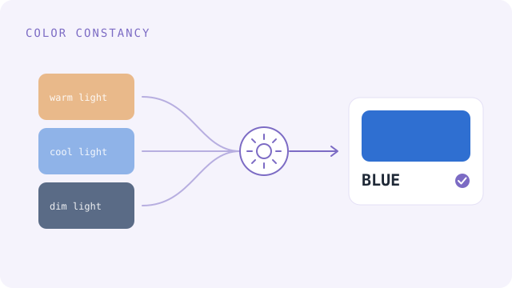
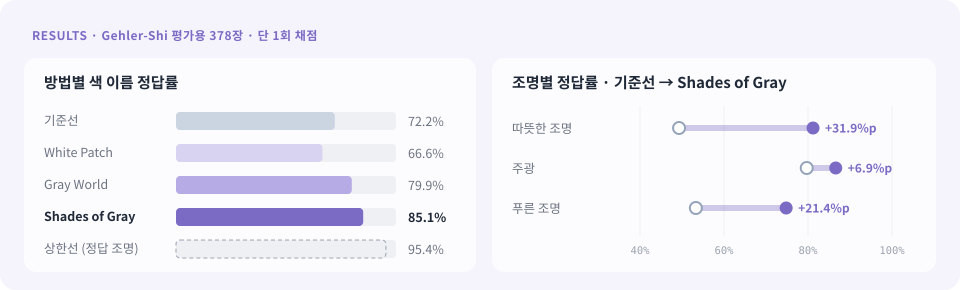
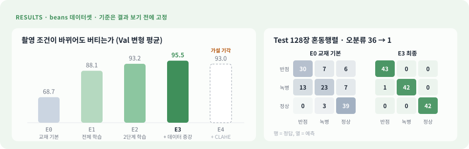
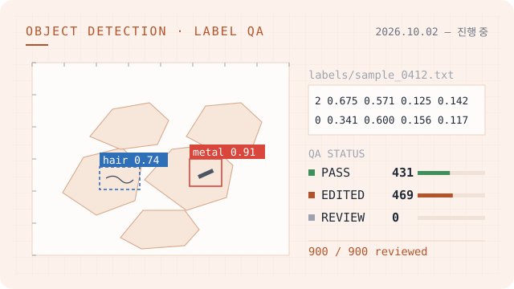
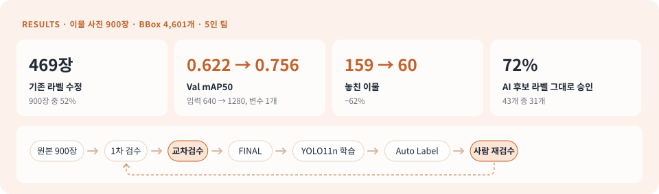
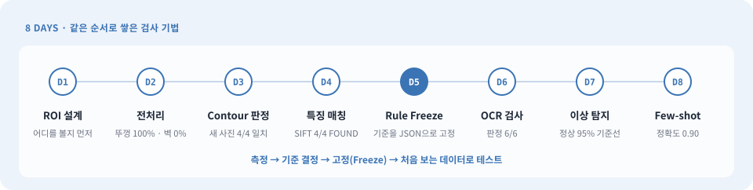
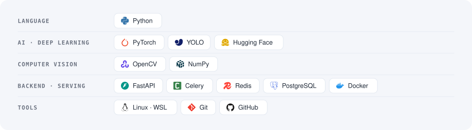

  

<h3 align="center">정답지부터 의심하고, 기준을 먼저 세우고, 숫자로 증명합니다.</h3>

  비전공에서 출발해 <b>라벨 검수 → 모델 학습 → 검사</b>까지 직접 해 본 신입 AI 개발자예요. 
  지금은 사람의 관절을 찾아 동작을 인식하는 <b>Pose Estimation</b>을 공부하고 있어요.

  

 

## Projects

<h3><a href="https://github.com/simpson92/TrueHue">TrueHue</a></h3>
2026.10.27 – 11.13 · 2인 팀 · 구현 주도

조명 색을 먼저 추정해 지운 뒤 색 이름을 붙이는 <b>색 이름 감별기</b>. 웹 · 폰 실시간 카메라 시제품까지 만들었어요.

<b>활용</b> &nbsp;OpenCV · NumPy · colour-science · FastAPI 
<b>결과</b> &nbsp;색 이름 정답률 <b>72.2% → 85.1%</b>

 

<b>자세히 보기</b> — 문제 · 방법 · 결과

 

<b>문제</b> &nbsp;같은 물건도 조명에 따라 찍힌 색이 달라서, 픽셀 색을 그대로 이름으로 바꾸면 조명이 바뀔 때 이름도 바뀌어요. 색각이상 사용자는 틀려도 알아차리기 어렵고요.

<b>방법</b> &nbsp;학습 없이 조명 추정 3가지(Gray World · White Patch · Shades of Gray)를 비교하고, 조명을 뺀 뒤 사람이 정한 11색 규칙으로 이름을 붙였어요. 공개 데이터셋을 보정용과 평가용으로 나누고, 채점 규칙을 먼저 고정한 다음 평가용은 단 한 번만 채점했어요.

<b>결과</b> &nbsp;Shades of Gray가 기준선보다 +12.9%p, 효과가 가장 큰 따뜻한 조명에서는 +31.9%p 올랐어요. 조명 추정 오차는 중앙값 1.68°(SimpleCube++ 462장)예요. 웹에서는 틀릴 수 있을 때 "판단하기 어려워요"라고 답하도록 했어요.

<b>배운 점</b> &nbsp;보정이 항상 좋아지는 건 아니었어요. White Patch는 오히려 −5.5%p였고, 그래서 비교 실험과 미리 정한 평가 규칙이 중요하다는 걸 배웠어요.

 

<h3><a href="https://github.com/simpson92/leaf-health-classifier">Leaf Health Classifier</a></h3>
2026.11.04 – 11.05 · 과제평가 · 개인

콩잎 사진 한 장으로 <b>정상 · 녹병 · 각진잎반점병</b>을 판별하는 Vision AI 웹 서비스예요.

<b>활용</b> &nbsp;ResNet18 · FastAPI · Celery · Redis · PostgreSQL 
<b>결과</b> &nbsp;Test 정확도 <b>71.9% → 99.2%</b>

 

<b>자세히 보기</b> — 문제 · 방법 · 결과

 

<b>문제</b> &nbsp;교재 기본 코드(출력층만 학습)는 Test 71.9%였고, 특히 녹병을 절반 가까이 놓쳤어요(Recall 53.5%).

<b>방법</b> &nbsp;2단계 학습 · 차등 학습률 · 코사인 스케줄 · label smoothing · 조기 종료에 데이터 증강을 더했어요. 병반 색이 단서라 색조 증강은 뺐어요. 최종 모델을 고르는 기준(Val → 촬영 조건 변화 평균)은 결과를 보기 전에 정했고, Test는 마지막에 한 번만 평가했어요.

<b>결과</b> &nbsp;녹병 Recall 53.5% → 97.7%, 오분류 36장 → 1장. 조명 보정(CLAHE)이 도움이 될 거라는 가설은 실험 결과 "밝게" 조건에서 오히려 떨어져 기각했어요.

<b>서빙</b> &nbsp;FastAPI 동기(200) / 비동기(202) + Celery · Redis · PostgreSQL. Redis 캐시로 8.9 → 1.5ms, 서버 시작 시 모델을 미리 올려 첫 요청을 2,407 → 48.8ms로 줄였어요.

<b>배운 점</b> &nbsp;비동기는 빨리 주는 기술이 아니라 서버를 붙잡지 않는 기술이라는 걸 직접 측정으로 확인했어요.

 

<h3><a href="https://github.com/simpson92/KH_Project_Subject7-8">조각김치 이물 검출</a></h3>
2026.10.02 – 진행 중 · 5인 팀 · QA · Data 담당

이물 사진 900장을 <b>직접 만든 검수 도구로 이중 검수</b>하고, 그 정답지로 YOLO 검출 모델을 학습 · 평가했어요.

<b>활용</b> &nbsp;tkinter 검수 GUI · YOLO11n · Ultralytics 
<b>결과</b> &nbsp;라벨 <b>900 / 900</b> 검수 · mAP50 <b>0.622 → 0.756</b>

 

<b>자세히 보기</b> — 문제 · 방법 · 결과

 

<b>문제</b> &nbsp;받은 원본 라벨을 그대로 믿을 수 없었어요. 검수해 보니 900장 중 52%(469장)를 고쳐야 했어요.

<b>방법</b> &nbsp;tkinter로 라벨 검수 도구 v4.1을 만들고(BBox 수정, PASS / EDITED / REVIEW, YOLO TXT + CSV 저장), 5명이 1차 검수한 뒤 다른 사람이 교차검수했어요. 모델은 촬영 세션 단위로 Split해 누출을 막고, Baseline → 실패 분석 → 변수 1개(입력 크기 640 → 1280)만 바꿔 개선했어요.

<b>결과</b> &nbsp;Val mAP50 0.622 → 0.756, 놓친 이물 159 → 60. Test는 한 번만 평가해 mAP50 0.606이 나왔고, 점수가 낮아진 원인(검증 세트 편중, 검증에 없던 촬영일)까지 확인했어요. 모델이 만든 후보 라벨은 72%가 그대로 승인됐어요.

<b>내 역할</b> &nbsp;라벨 검수 단계 QA / Test, 모델 단계 Data / QA · Training. 데이터셋 통계, 다른 PC 재현, 코드 리뷰 문서, Auto Label 공식 검수를 맡았어요.

 

<h3><a href="https://github.com/simpson92/KH_Project_Subject9">병뚜껑 유무 검사 · 머신비전</a></h3>
2026.10.27 – 11.03 · 교과 실습 · 개인

딥러닝 없이 <b>OpenCV 규칙만으로</b> 병뚜껑 유무를 판정하는 검사기. 측정 → 기준 고정 → 테스트 순서로 만들었어요.

<b>활용</b> &nbsp;ROI · Otsu · Morphology · Contour · Feature Matching

 

<b>자세히 보기</b> — 문제 · 방법 · 결과

 

<b>목표</b> &nbsp;검사기를 바로 만드는 게 아니라, 어디를 보고 무엇으로 정상과 불량을 구분할지부터 정하는 머신비전 검사를 익혔어요.

<b>과정</b> &nbsp;ROI → 전처리(Otsu, 13가지 비교 후 선택) → Morphology · Contour로 면적 비율 판정 → SIFT + Homography 로고 매칭 → Calibration · Rule Freeze → OCR 문자 검사 → 이상 탐지(MVTec AD) → One-shot · Few-shot 순서로 쌓았어요.

<b>결과</b> &nbsp;병뚜껑 기준(면적 비율 0.3608)을 고정한 뒤 새 사진 4장 모두 일치, 로고 매칭 4/4, OCR 검사 6/6, Few-shot 정확도 0.90.

<b>배운 점</b> &nbsp;숫자를 먼저 정하지 않고 측정한 뒤 기준을 만든다. Test를 보고 기준을 바꾸면 그건 더 이상 Test가 아니다.

 

## Tech Stack

 

## Education

<b>[비솔] 현장 데이터 기반 Vision AI &amp; 산업분야 Vertical AI 융합 전문가 양성</b> 
KH정보교육원 · K-디지털 트레이닝 · 2026.07 – 2027.02 (수료 예정)

 

  Thanks for visiting · <a href="https://github.com/simpson92">@simpson92</a>

