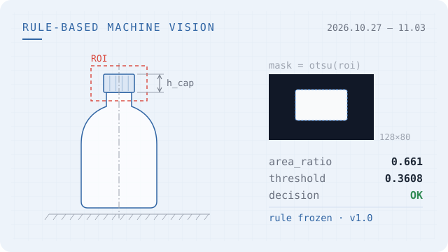

  

<h3 align="center">정답지부터 의심하고, 기준을 먼저 세우고, 숫자로 증명합니다.</h3>

  비전공에서 출발해 <b>라벨 검수 → 모델 학습 → 검사</b>까지 직접 해 본 신입 AI 개발자예요. 
  지금은 사람의 자세를 읽는 AI를 만들고 있고, 다음 목표는 <b>동물의 행동과 건강을 읽는 AI</b>입니다. 🐾

  
  
  
  
  
  
  

 

## Projects

<h3><a href="https://github.com/simpson92/TrueHue">TrueHue</a></h3>
2026.10 – 11 · 2인 팀 · 구현 주도

조명 색을 먼저 추정해 지운 뒤 색 이름을 붙이는 <b>색 이름 감별기</b>. 웹 · 폰 실시간 카메라 시제품까지 만들었어요.

<b>활용</b> &nbsp;OpenCV · NumPy · colour-science · FastAPI 
<b>결과</b> &nbsp;색 이름 정답률 <b>72.2% → 85.1%</b>

 

<h3><a href="https://github.com/simpson92/leaf-health-classifier">Leaf Health Classifier</a></h3>
2026.11 · 과제평가 · 개인

콩잎 사진 한 장으로 <b>정상 · 녹병 · 각진잎반점병</b>을 판별하는 Vision AI 웹 서비스예요.

<b>활용</b> &nbsp;ResNet18 · FastAPI · Celery · Redis · PostgreSQL 
<b>결과</b> &nbsp;Test 정확도 <b>71.9% → 99.2%</b>

 

<h3><a href="https://github.com/simpson92/KH_Project_Subject7-8">조각김치 이물 검출</a></h3>
2026.10 · 5인 팀 · QA · Data 담당

이물 사진 900장을 <b>직접 만든 검수 도구로 이중 검수</b>하고, 그 정답지로 YOLO 검출 모델을 학습 · 평가했어요.

<b>활용</b> &nbsp;tkinter 검수 GUI · YOLO11n · Ultralytics 
<b>결과</b> &nbsp;라벨 <b>900 / 900</b> 검수 · mAP50 <b>0.622 → 0.756</b>

 

<h3><a href="https://github.com/simpson92/KH_Project_Subject9">병뚜껑 유무 검사 · 머신비전</a></h3>
2026.10 – 11 · 교과 실습 · 개인

딥러닝 없이 <b>OpenCV 규칙만으로</b> 병뚜껑 유무를 판정하는 검사기. 측정 → 기준 고정 → 테스트 순서로 만들었어요.

<b>활용</b> &nbsp;ROI · Otsu · Morphology · Contour · Feature Matching

 

 

  Thanks for visiting · <a href="https://github.com/simpson92">@simpson92</a>

