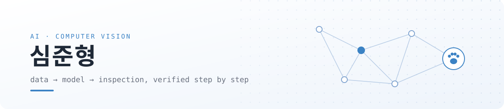
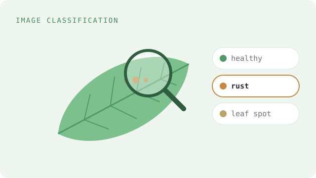
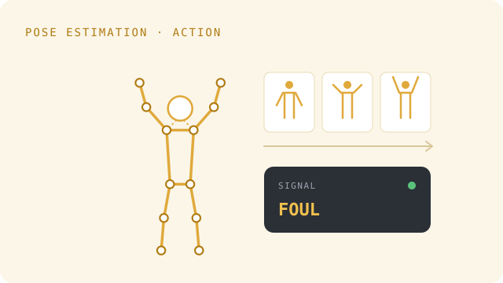

  

<h3 align="center">정답지부터 의심하고, 기준을 먼저 세우고, 숫자로 증명합니다.</h3>

  비전공에서 출발해 <b>라벨 검수 → 모델 학습 → 검사</b>까지 직접 해 본 신입 AI 개발자예요. 
  지금은 사람의 자세를 읽는 AI를 만들고 있고, 다음 목표는 <b>동물의 행동과 건강을 읽는 AI</b>입니다. 🐾

  
  
  
  
  
  
  

 

## Projects

<table>
  <tr>
    <td width="40%">
      
    </td>
    <td width="60%" valign="top">
      <h3><a href="https://github.com/simpson92/TrueHue">TrueHue</a></h3>
      2026.10 – 11 · 2인 팀 · 구현 주도
      
조명 때문에 색이 다르게 찍혀도 속지 않는 <b>색 이름 감별기</b>. 사진에서 조명 색을 먼저 추정해 지운 뒤, 사람이 정한 11색 규칙으로 이름을 붙입니다. 웹과 폰 실시간 카메라로 쓸 수 있는 시제품까지 만들었어요.

      
<b>활용</b> &nbsp;Python · OpenCV · NumPy · colour-science · FastAPI 
      <b>결과</b> &nbsp;색 이름 정답률 <b>72.2% → 85.1%</b> (봉인 평가 378장, 단 1회 채점)

    </td>
  </tr>
  <tr>
    <td width="40%">
      
    </td>
    <td width="60%" valign="top">
      <h3><a href="https://github.com/simpson92/leaf-health-classifier">Leaf Health Classifier</a></h3>
      2026.11 · 과제평가 · 개인
      
콩잎 사진 한 장으로 <b>정상 · 녹병 · 각진잎반점병</b>을 판별하는 Vision AI 웹 서비스. 기본 코드에서 출발해 학습 방법을 개선하고, 동기/비동기 처리 구조의 차이를 직접 측정했어요.

      
<b>활용</b> &nbsp;PyTorch · ResNet18 Fine-tuning · FastAPI · Celery · Redis · PostgreSQL · Docker Compose 
      <b>결과</b> &nbsp;Test 정확도 <b>71.9% → 99.2%</b> · 녹병 Recall 53.5% → 97.7%

    </td>
  </tr>
  <tr>
    <td width="40%">
      
    </td>
    <td width="60%" valign="top">
      <h3><a href="https://github.com/simpson92/KH_Project_Subject7-8">조각김치 이물 검출</a></h3>
      2026.10 · 5인 팀 · QA / Test · Data / Training 담당
      
식품 공장 이물 사진 900장의 라벨을 <b>직접 만든 검수 도구로 이중 검수</b>하고, 그 정답지로 YOLO 검출 모델을 학습 · 평가했어요. 모델이 만든 라벨을 다시 사람이 검수하는 한 사이클까지 완성했습니다.

      
<b>활용</b> &nbsp;Python · tkinter (라벨 검수 GUI) · YOLO11n · Ultralytics 
      <b>결과</b> &nbsp;라벨 <b>900 / 900</b> 검수 (기존 라벨 52% 수정) · Val mAP50 <b>0.622 → 0.756</b>

    </td>
  </tr>
  <tr>
    <td width="40%">
      
    </td>
    <td width="60%" valign="top">
      <h3><a href="https://github.com/simpson92/KH_Project_Subject9">병뚜껑 유무 검사 · 머신비전</a></h3>
      2026.10 – 11 · 교과 실습 · 개인
      
딥러닝 없이 <b>OpenCV 규칙만으로</b> 병뚜껑이 있는지 판정하는 검사기를 단계별로 쌓아 올린 실습. 먼저 측정하고, 기준을 정해 고정(Freeze)한 다음 테스트하는 순서를 몸에 익혔어요.

      
<b>활용</b> &nbsp;OpenCV · ROI · CLAHE / Otsu · Morphology · Contour · Feature Matching · OCR · Anomaly Detection

    </td>
  </tr>
  <tr>
    <td width="40%">
      
    </td>
    <td width="60%" valign="top">
      <h3><a href="https://github.com/simpson92/KH_Project_Subject10">농구 심판 수신호 인식</a> &nbsp;</h3>
      2026.11 – 현재 · 팀 프로젝트
      
YOLO Pose로 사람의 관절을 찾아 각도 · 거리 같은 숫자 Feature로 바꾸고, <b>심판의 파울 수신호를 인식해 전광판에 띄우는</b> 프로젝트예요. 모션캡처(VICON) 데이터도 함께 다룹니다.

      
<b>활용</b> &nbsp;YOLO11 Pose · OpenCV · VICON 모션캡처 · FastAPI

    </td>
  </tr>
</table>

 

  Thanks for visiting · <a href="https://github.com/simpson92">@simpson92</a>

